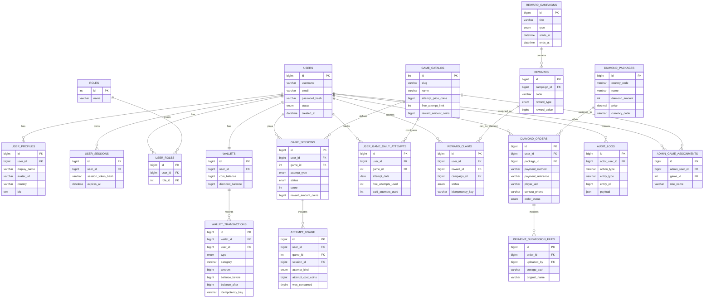

# ERD

## 1. Mermaid ERD

## 2. Relationship notes

- Each user has one wallet and optional profile metadata.
- Wallet transactions always belong to a wallet and a user.
- Game sessions are tied to one user and one game.
- A game usage event is linked to a specific session if applicable.
- Reward claims are tied to campaigns and reward definitions.
- Diamond orders are separate from wallet coins and must never be mixed at the balance layer.
- Audit logs record all sensitive activities.

## 3. Design interpretation

This entity relationship is intentionally normalized enough to support full implementation while keeping the final architecture easy to expand with new games or admin responsibilities.
